# Onboarding: how VibeDocWithSoap works

This is the long version. It walks through every folder in `packages/core/src` (and the `ui` package and the examples) as a chapter. Each chapter says what the folder is for, what problem it exists to solve, what the alternatives were, how it works, and what to watch out for.

If you only have ten minutes, read **Part 1** and the three journeys. If you are about to change something, read the chapter for that folder and the ones it depends on.

> **Status.** Everything here was written without being run. Where this document says "does", read "is meant to do". [known-issues.md](known-issues.md) lists where to look first when something is wrong.

## Contents

**Part 1: The big picture**
- [What VibeDocWithSoap is](#what-vibedocwithsoap-is)
- [The idea in one picture](#the-idea-in-one-picture)
- [Three journeys](#three-journeys)
- [How the folders depend on each other](#how-the-folders-depend-on-each-other)
- [Words used here](#words-used-here)

**Part 2: The foundations**
1. [`util`](#chapter-1-util)
2. [`dom`](#chapter-2-dom)
3. [`model`](#chapter-3-model)
4. [`commands`](#chapter-4-commands)

**Part 3: Keeping a document in bounds**
5. [`rules`](#chapter-5-rules)
6. [`sanitize`](#chapter-6-sanitize)
7. [`knobs` and `fonts`](#chapter-7-knobs-and-fonts)

**Part 4: Understanding changes**
8. [`diff`](#chapter-8-diff)
9. [`review`](#chapter-9-review)

**Part 5: The door**
10. [`editing`](#chapter-10-editing)
11. [`ai`](#chapter-11-ai)
12. [`persistence`](#chapter-12-persistence)

**Part 6: Showing the document**
13. [`rendering`](#chapter-13-rendering)
14. [`presentation`](#chapter-14-presentation)
15. [`editor`](#chapter-15-editor)

**Part 7: Around the core**
16. [`packages/ui`](#chapter-16-packagesui)
17. [`examples`](#chapter-17-examples)
18. [Tests](#chapter-18-tests)

**Part 8: Working in the code**
- [Where do I add...?](#where-do-i-add)
- [Things that will confuse you](#things-that-will-confuse-you)

---

# Part 1: The big picture

## What VibeDocWithSoap is

VibeDocWithSoap is a library for building **document editors where a person and an AI work on the same page**. Think of a CV builder, a contract editor, an invoice tool: documents that have a fixed look and fresh content each time.

Three things are true about those products, and the whole design follows from them:

1. **The AI is fast and sometimes wrong.** It can restructure and restyle a whole document in seconds, and it will occasionally invent a fact or change something nobody asked about.
2. **The person must stay in control.** They check the numbers, fix a word, and approve what the AI did.
3. **What you see must be what prints.** A CV that breaks differently on paper than on screen is a broken CV.

So VibeDocWithSoap is not "an editor". It is the layer that makes a document **safe for both of them to change**: one door every change goes through, a diff the person reviews before anything the AI did becomes real, rules about what a document may contain, and pages that match print. The toolbar, the chat and the panels are the host app's job.

### What the library does and does not do

| VibeDocWithSoap does | VibeDocWithSoap does not |
|---|---|
| Draw the document on paper-sized pages | Draw your toolbar, chat or panels |
| Take typing, Enter, Backspace, paste, undo | Call a model, hold an API key, write a prompt |
| Check every change against rules | Store anything (it hands you a snapshot of JSON) |
| Show an AI revision as a diff to keep or undo | Make PDF files on a server (it prints, or gives you HTML) |
| Keep versions and undo history | Merge edits made while the AI works (the page is locked) |

## The idea in one picture

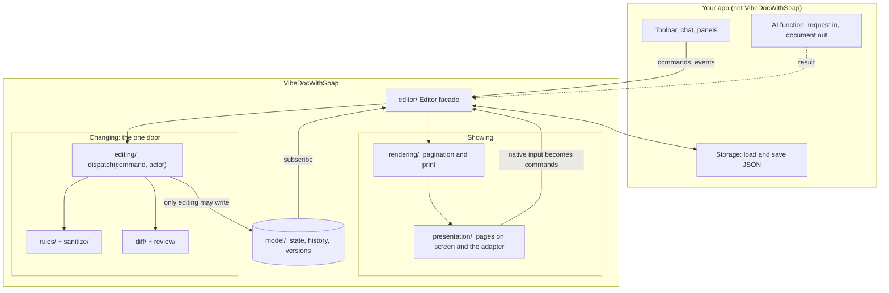

Read it from the middle out:

- **The model** holds the document. Nobody can change it except `editing`.
- **`editing`** is the only door. A person's typing, a button in your toolbar and the AI's result all arrive as commands at the same place.
- **`rules` and `sanitize`** decide whether a change may go through and clean what comes in.
- **`diff` and `review`** turn "the AI rewrote the document" into "here are the eleven things it changed, keep or undo each".
- **`rendering` and `presentation`** read the state and draw pages. They never write to it.
- **`editor`** wires all of this into one object.

### Why this shape

The earlier version of this project had one 1,500-line file that mixed what a document *is*, what may *happen* to it, and how it is *drawn*. Nothing could be tested without a browser and every bug was a guess. The shape above is the cure: **each part knows one thing**, and the arrows only point one way.

Alternatives that were considered:

| Alternative | Why not |
|---|---|
| Use a document engine (ProseMirror, TipTap, Lexical) | They parse HTML into their own schema and drop what the schema does not know. The AI writes arbitrary HTML and CSS; an engine would either lose that or need a schema so generic it rebuilds what it replaces. They also would not give you the review layer or pagination. |
| Build it inside a framework (Angular, React) | A framework helps keep a UI in sync with state. The hard problems here (the caret, text input, pagination) are below that, and a framework's re-rendering fights native editing. It would also tie the library to the framework. |
| Classic MVC where the view and model call each other | That is how the earlier tangle grew. Data flows one way instead: events up as commands, state down as renders. |

## Three journeys

The fastest way to understand the code is to follow one action through it. These three cover almost everything.

### Journey 1: a person types a letter

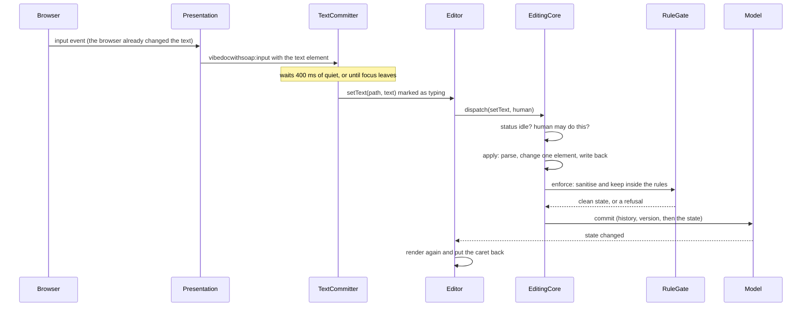

Things to notice:

- **The browser edits the text, not VibeDocWithSoap.** Each text element is `contenteditable="plaintext-only"`. VibeDocWithSoap only notices afterwards and tells the model. This keeps the caret, spell check, selection and input methods working without rebuilding them.
- **One command per pause, not per keystroke.** Otherwise history, versions and the diff would be flooded.
- **The model is updated after the fact.** Typing is the one place where the page is ahead of the model for a few hundred milliseconds. Everything else is model first.

### Journey 2: the AI revises the document

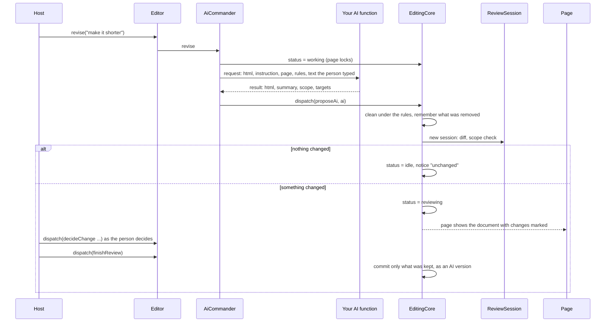

Things to notice:

- **The AI never writes to the model.** Its result becomes a *proposal*. Only the parts the person keeps are committed.
- **The page is locked** from the moment the AI starts until the review ends. There is no merging. The person waits.
- **Two safety checks run on what the AI returned:** the rules (content, fonts) and the scope check (did it do what it said it did?).

### Journey 3: printing

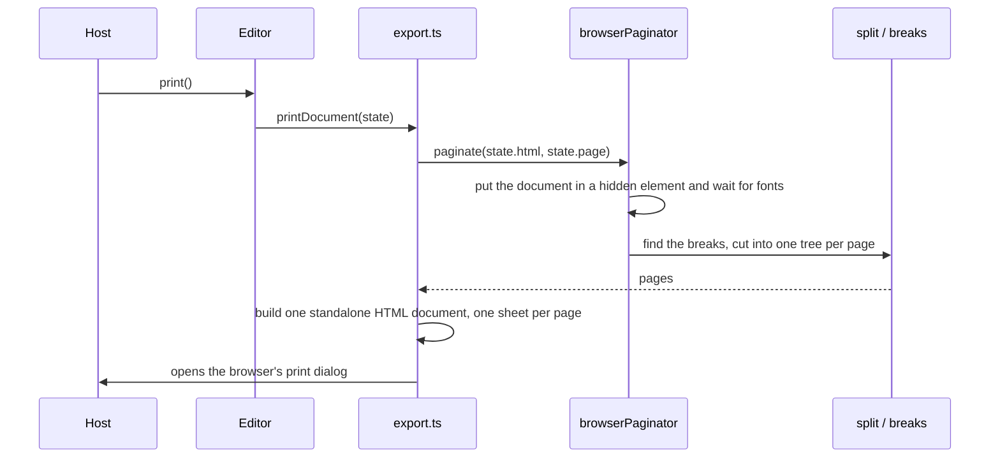

Things to notice:

- **Export reads the state, never the page the person is editing.** The live page has editing attributes, a caret and review markers. A clean copy is measured and paginated again.
- **The same pagination** draws the screen and builds the print document, so they cannot drift apart for lack of sharing code.

## How the folders depend on each other

A folder may only import from folders **above** it in this graph. This is the single most useful rule in the codebase: it is what keeps the logic testable without a browser.

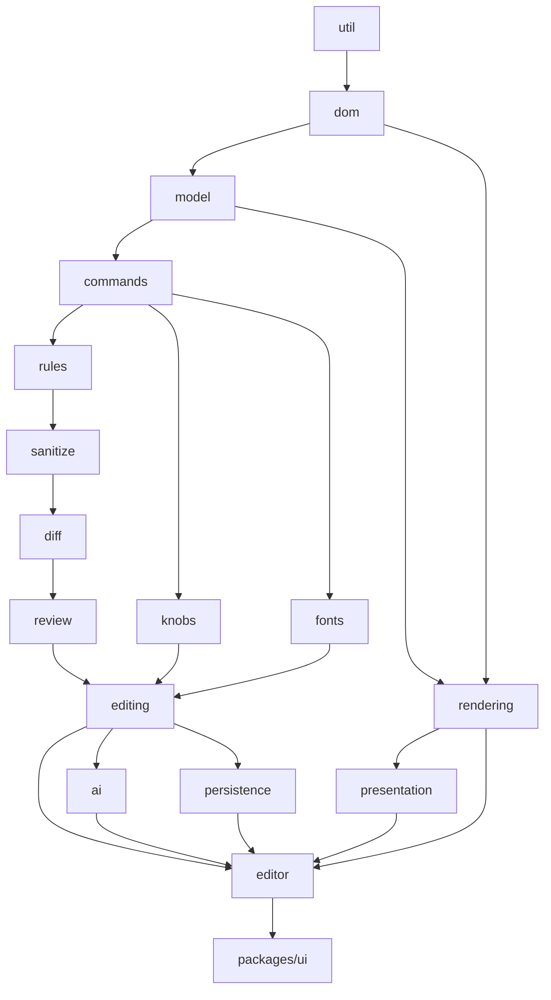

Two honest notes about this graph:

- It is a simplification. `presentation` takes a little CSS from `rendering` (the baseline a document starts from), and `diff` and `review` use `dom` directly. The rule that matters: **nothing in `util`, `dom`, `model`, `commands`, `rules`, `sanitize`, `diff`, `review` or `editing` knows a page exists.** They need a DOM *parser* (so they run in a test with `happy-dom`) but never a laid-out page.
- Nothing enforces the graph. It holds because it was written that way. A lint rule that fails the build on a wrong import would be a good addition.

## Words used here

| Word | Meaning |
|---|---|
| **Document** | An HTML string: some `<style>` elements and some content. |
| **State** | `{ html, page }`: the document and its paper setup. Nothing else. |
| **Command** | One thing that can be done to a document: `setText`, `moveElement`, `setPage`... Plain data. |
| **Actor** | Who is doing it: `"human"` or `"ai"`. |
| **Dispatch** | Handing a command to the editing core. Returns a result: it worked, or why not. |
| **Unit** | An element holding only text (and line breaks), or an image. The smallest thing the diff compares and a person edits. |
| **Block** | A group of units marked `data-block="id"`. The AI names the blocks it changed; pagination keeps small blocks together. |
| **Path** | Child indexes from the root to an element, like `[1, 0, 3]`. How a command says which element. |
| **Proposal** | An AI revision waiting for the person's decision. |
| **Review** | The state while a proposal is open. The document is locked. |
| **Rules** | Plain data: what a document may contain, which fonts and paper, who may do what. |
| **Violation** | Something a rule removed or refused. |
| **Knob** | A setting a document declares for itself (a CSS variable with a `@knob` comment) that a host can show as a slider. |
| **Snapshot** | The state plus its versions, as plain JSON. What a host saves. |
| **Sheet** | One page of paper as drawn on screen. |
| **Reference engine** | Chromium. Where browsers differ, what Chromium does is the truth. |

---

# Part 2: The foundations

These four folders know nothing about editing, rules or pages. Everything above them is built from these.

## Chapter 1: `util`

**What it is.** Two tiny helpers used everywhere.

| File | What it does |
|---|---|
| `emitter.ts` | `Emitter<Args>`: a set of listeners for one kind of event. `on(listener)` returns a function that removes it; `emit(...args)` calls them; `clear()` removes all. |
| `event-bus.ts` | `EventBus<Events>`: named events with typed arguments, built from emitters. `bus.on("state", (state, previous) => ...)`. |
| `id.ts` | `createId(prefix)`: a short unique id such as `v1k3x9a2b`. |

**The problem.** Many parts of VibeDocWithSoap have to tell others "something changed" (the model, the status, the review, autosave, the editor itself). Without a shared tool each one invents its own list of callbacks and its own way to unsubscribe.

**Alternatives.**

| Option | Verdict |
|---|---|
| `EventTarget` and `CustomEvent` (browser native) | Needs a DOM and is not typed. These parts should work in a test with no page. |
| An observable library (RxJS) | Far more than needed, and a dependency. |
| One global event bus | Everything could talk to everything, which is what the layers exist to prevent. Each emitter is owned by the thing that fires it. |

**How it works, and one subtlety.**

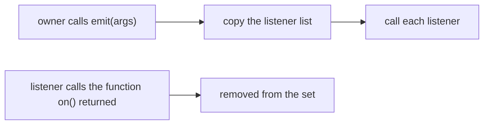

`emit` loops over a **copy** of the listeners. A listener is allowed to unsubscribe itself while it runs; looping over the live set would skip the next listener.

**Watch out.** A listener that throws stops the others after it. There is no error isolation. That is deliberate: a throw is a bug to be seen, not swallowed.

---

## Chapter 2: `dom`

**What it is.** Everything that has to read or write a document's structure. The document is an HTML string; this folder is the one place that turns it into elements and back.

| File | What it does |
|---|---|
| `parse.ts` | `parseHtml(html)` returns a detached `<div>` holding the parsed document. `toHtml(root)` is its `innerHTML`. `cleanModelHtml` strips a code fence or a doctype a model sometimes wraps around HTML. |
| `paths.ts` | `ElementPath` (`[1, 0, 3]`), `elementPath(el, root)`, `elementAt(root, path)`, `pathKey`/`parsePathKey` (`"1.0.3"`), `stampPaths(root)` and `pathOfStamped(el)` (the `data-vibedoc-path` attribute). |
| `tags.ts` | The tag sets: which are replaced content (`IMG`, `SVG`...), skipped (`STYLE`, `SCRIPT`...), empty-but-editable (`P`, `H1`, `LI`...), and where Enter starts a new element (`PARAGRAPH_TAGS`). |
| `units.ts` | `holdsOnlyText`, `isTextUnit`, `collectUnits(root)`, `blockIdOf`, `isSkipped`. Defines what a **unit** is. |
| `text.ts` | `unitText(el)` reads a unit's text with `<br>` as `\n`. `setUnitText(el, text)` does the reverse. `normalizedText` collapses whitespace, for comparing versions. |
| `normalize.ts` | `normalizeTextElements(root)`: enforces one style per text element. |

### The problem: the document is a string, but you need to edit it

State is an HTML string because a string can be saved, compared, kept in history and sent anywhere. But "change the third paragraph" needs structure. So every edit is: **parse, change a tree, write back**. `dom/` is that bridge.

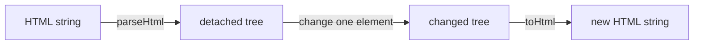

**Alternatives.**

| Option | Verdict |
|---|---|
| Keep the document as a live DOM and treat that as the state | Native and simple, but the state cannot be saved, compared, put in history or validated on a server without serialising. And editing, rules and the AI path end up tangled with the browser page. This was the earlier version. |
| Keep a custom tree of plain objects (like ProseMirror's) | Gives stable ids and cheap diffs, but now there are two representations to keep in sync and a schema deciding what may exist, which is what we are trying not to have. |
| Parse with a library (`parse5`) so it runs with no DOM at all | Would let the core run on a server. For now `DOMParser`/`<template>` (browser, `happy-dom` in tests) was simpler. Open question in [decisions.md](decisions.md). |

### Addressing elements: paths

A command must say *which* element. The choice was a **path**: child indexes from the root.

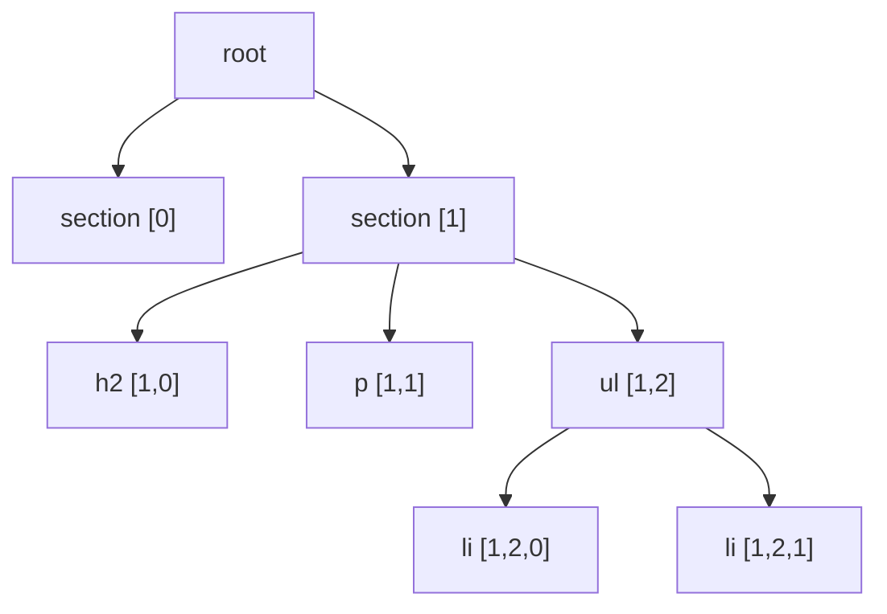

| Option | Verdict |
|---|---|
| **Path** (chosen) | Needs nothing in the HTML. Cheap. Valid as long as the structure has not changed. |
| A stable id on every element (`data-id`) | Survives moves and inserts, but every parse must assign ids, and when the AI replaces the whole HTML you need a matching step to carry ids over. Open question. |
| An object reference to a DOM node | Cannot be sent, saved or used on a server. |

Paths are good for the length of **one command**: the page and the model agree, the command is applied, and the result is read back. The page stamps every element with `data-vibedoc-path` so an event can say which element it came from.

**The catch.** After a command that inserts or removes elements, every later path in the same parent is different. That is fine because the page is re-rendered (and re-stamped) from the new state before the next command. It would not be fine to keep a path for later.

### What is a unit?

A **unit** is an element whose only content is text and line breaks (a paragraph, a heading, a list item, a span in a flex row) or a standalone image. `collectUnits` stops descending at a unit, so units never nest.

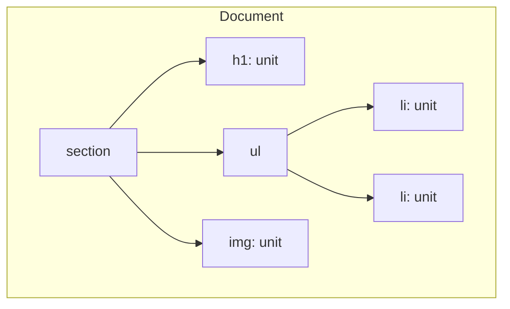

Why it matters: **three different parts of VibeDocWithSoap agree on this one definition.** A person types in units. The diff compares units. The review marks units. If any of them disagreed, edits and changes would not line up.

`holdsOnlyText` is the looser version: "could hold typed text", even when empty. An empty `<span>` is not a unit (there is nothing to compare) but it can still be typed into, so `setText` uses `holdsOnlyText`.

### One style per text element

`normalizeTextElements` makes sure no element mixes text with other elements:

```html
before:  <p>Hello <b>there</b> friend</p>
after:   <p><span>Hello</span> <b>there</b> <span>friend</span></p>
```

**The problem.** Typing into text that has a bold word in the middle is where every rich-text editor gets hard. Where does the new letter's style come from? What does Backspace do at the edge of the bold? Mixed formatting is what makes editors complicated.

**The solution.** Make it impossible: every piece of text is alone in an element. A unit has no style boundaries inside it, so the browser has nothing to mangle. Formatting is expressed as *separate elements*, which is exactly what flex rows and badges already look like.

| Option | Verdict |
|---|---|
| Allow mixed formatting and handle it | That is writing a rich-text editor. Months of work, and the thing every document engine spends years on. |
| Strip the formatting | Loses what the AI designed. |
| **Wrap loose text in its own span** (chosen) | Looks identical, and every piece is editable on its own. |

**The cost.** A paragraph with three formatted words is three elements. A person cannot select across them and retype as one. To change mixed formatting, ask the AI or edit each piece.

**Watch out.** Normalising is applied by the sanitiser, so it happens to everything that enters the document. If you add a path into the document that skips the sanitiser, units will not be well-formed.

---

## Chapter 3: `model`

**What it is.** The state of the document and everything kept beside it.

| File | What it does |
|---|---|
| `state.ts` | `DocumentState = { html, page }`, `createState`, `sameState`, and the `Actor` type. |
| `page.ts` | Paper sizes, margins, paper colour. `pageGeometry(page)` gives sizes in CSS pixels (content width and height included). `safeColor` guards a colour that goes into CSS. |
| `state-model.ts` | `createStateModel(initial)` returns a read-only `model` and a separate `writer`. |
| `history.ts` | `UndoHistory`: undo and redo as snapshots, with burst coalescing. |
| `versions.ts` | `VersionLog`: the list of versions, oldest first. |
| `snapshot.ts` | `DocumentSnapshot`: state plus versions as plain JSON, `createSnapshot`, `parseSnapshot`. |

### The state is small on purpose

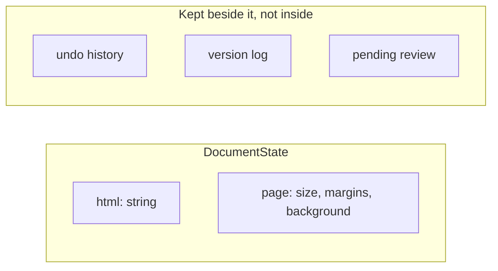

**The problem.** If undo history, versions and a pending review live inside the state, then "the state" is big, and everything that reads it (the renderer, export, the diff) is entangled with things it does not need.

**The solution.** The state is exactly what is needed to draw or print the document. History, versions and review are held elsewhere (`editing/`) and joined in the **snapshot** only when saving.

### The model can only be changed through editing

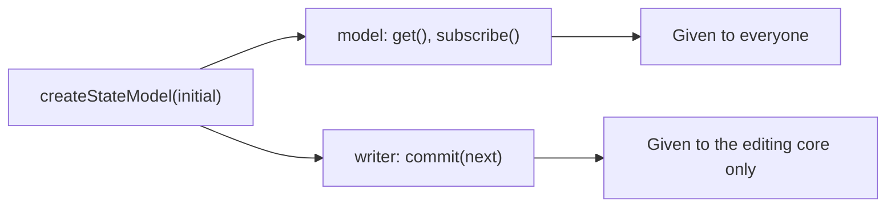

`createStateModel` returns **two objects**. Everyone gets the read-only one. Only `editing` is handed the writer.

| Option | Verdict |
|---|---|
| A `commit` method on the model, with a comment saying "only call from editing" | A convention. It lasts until a deadline. |
| A lint rule banning imports | Possible; catches mistakes, but the capability is still there to misuse. |
| **Hand out the writer separately** (chosen) | "The model can only be changed through editing" is a fact about who holds a reference. A test checks that `"commit" in model` is false. |

### Undo history

`UndoHistory` keeps whole earlier states. `record(before, key)` is called before each change.

**The problem.** Typing a paragraph is dozens of commands. One undo per command would make Ctrl+Z almost useless.

**The solution.** Commands carry a **history key** (`editing/history-key.ts`): typing in one element is `text:0.2`, dragging a slider is `knob:--font-size`. Edits with the same key within one second share a step.

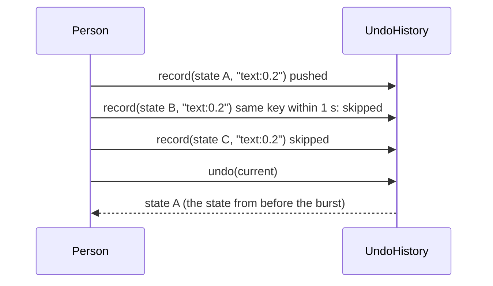

| Option | Verdict |
|---|---|
| Store inverse operations (a patch per command) | Smaller, but every command needs a correct inverse. A bug there corrupts history. |
| **Store whole states** (chosen) | One string copy per step. Trivially correct. Memory grows with document size times steps (the limit is 200). |

**Watch out.** Coalescing uses the wall clock (`Date.now`). It is injectable (`now`) for tests.

### Versions

`VersionLog` is the *named* history: who made each version (`human` or `ai`), a summary, a time.

The one subtle rule is in `record`: **consecutive plain human edits share one version.** Typing a paragraph should not create thirty versions. But a version that has a **summary** is never merged into, because it was recorded on purpose:

- the initial document (`"Initial document"`),
- a restore (`"Restored: ..."`),
- an undo or redo,
- anything the AI wrote.

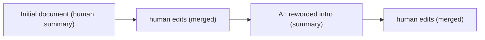

### Snapshots

A `DocumentSnapshot` is `{ schemaVersion, state, versions }`. `parseSnapshot` validates a value from storage and throws if it is not usable (a missing page is filled in with the default).

**Why a version number.** Stored data outlives code. `schemaVersion: 1` lets a future change say "I know how to read versions 1 and 2" instead of guessing.

**Watch out.** Versions are never pruned. A long-lived document's snapshot grows forever. Noted in [known-issues.md](known-issues.md).

---

## Chapter 4: `commands`

**What it is.** The vocabulary of change. Every possible change to a document is a plain-data command; this folder defines them, who may use which, and what comes back.

| File | What it does |
|---|---|
| `commands.ts` | The `Command` union: document, history, review and AI commands. `AiDocument`, `ChangeScope`, `NewElement`. |
| `kinds.ts` | The kinds grouped (`DOCUMENT_KINDS`, `HISTORY_KINDS`, `REVIEW_KINDS`, `AI_KINDS`), `isDocumentKind` etc., and `DEFAULT_PERMISSIONS`. |
| `result.ts` | `EditResult` (success or failure), error codes, `Notice`, `Caret`, `RuleViolation`, and `succeeded`/`failed`/`isFailure`. |
| `new-elements.ts` | Builders for `insertElement`: `paragraph()`, `heading()`, `textBox()`. |

### The problem: many sources, one effect

A document can be changed by typing, by your toolbar, by the AI, by undo, by a keyboard shortcut. If each source reached in and changed the document its own way, there would be five places to enforce rules and five ways for state and page to disagree.

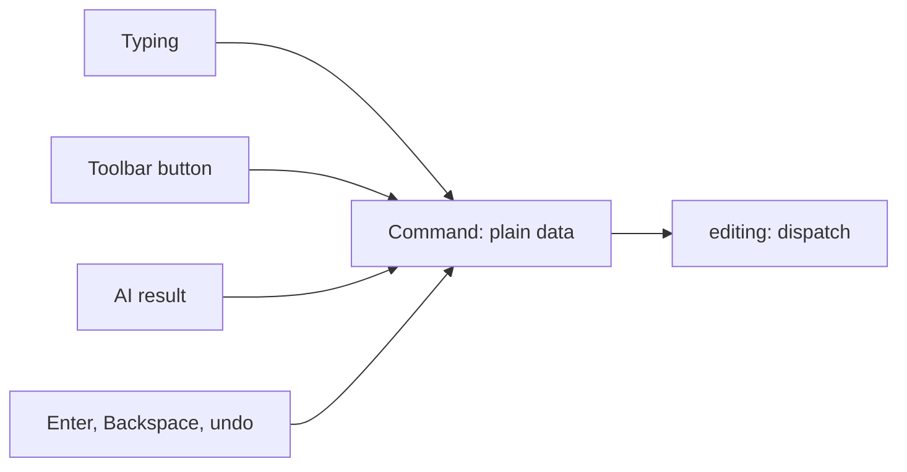

A **command is data**, not a function call. That gives you things for free: it can be logged, replayed in a test, refused, sent over a wire, and checked against a permission *before* it does anything.

### The command families

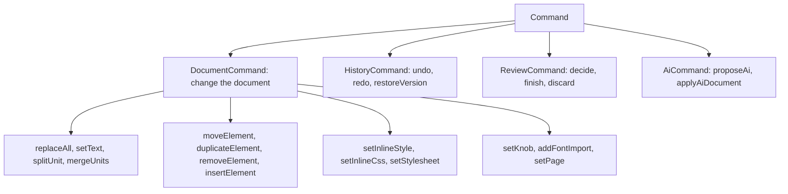

The full list with what each does is in [commands.md](commands.md).

### Who may do what

`DEFAULT_PERMISSIONS`:

| Actor | May use |
|---|---|
| `human` | document, history and review commands |
| `ai` | only `proposeAi` and `applyAiDocument` |

The AI cannot call `setText` or `removeElement`. It can only *hand in work*, which becomes a proposal. A document's rules can replace either list.

### Results instead of exceptions

`dispatch` returns an `EditResult`:

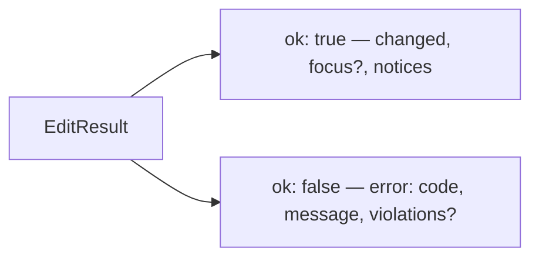

| Option | Verdict |
|---|---|
| Throw on failure | A refused command is **normal**: the font is not allowed, the page is locked, the path leads nowhere. Exceptions make every call site wrap in try/catch and make it easy to forget. |
| Return `null` or a boolean | Loses the reason. A UI wants to say *why* (and a person wants to know). |
| **A result object with a code and a message** (chosen) | The caller must look. `isFailure(result)` narrows the type. |

Error codes: `not-allowed`, `locked`, `invalid`, `rule-violation`, `nothing-to-do`, `no-review`, `no-provider`, `cancelled`, `ai-error`.

`changed: false` on a success means "valid, but the document ended up the same" (for example, setting text to what it already was). It is not an error.

### Carets travel in the result

`splitUnit` (Enter) and `mergeUnits` (Backspace) return `focus: { path, offset }`. **The command says where the caret belongs; the view puts it there.** The command layer decides (it knows where the new element is); only the view can move a caret.

### Why commands sit below rules

`rules` needs to know the command kinds ("may the human use `removeElement`?"). So `commands` must not depend on `rules`. That is why `RuleViolation`, which both use, is defined in `commands/result.ts`.

**Watch out.** Adding a command means touching several places. [Where do I add...?](#where-do-i-add) lists them.

---

# Part 3: Keeping a document in bounds

An AI writes arbitrary HTML and CSS. A person can paste, type and restyle. A host product usually wants documents to stay within limits: "text only", "A4 only", "these two fonts". This part is how that is enforced.

## Chapter 5: `rules`

**What it is.** A plain data object saying what a document may contain, which fonts and paper it may use, and who may do what, plus the code that checks things against it.

| File | What it does |
|---|---|
| `types.ts` | `DocumentRules`, `ContentLevel`, `ContentAllow`, `PageRules`, `PermissionRules`. |
| `resolve.ts` | `resolveRules(rules)` fills in every default and returns `ResolvedRules`. |
| `tags.ts` | `allowedHtmlTags(rules, base)`: which HTML tags a document may contain. |
| `fonts.ts` | Parsing font names from CSS and deciding if they are allowed. |
| `css-filter.ts` | `filterCss(css, rules)`: removes forbidden declarations from CSS text. |
| `page-rules.ts` | `checkPage`, `fitPage`: is a page setup allowed, and the nearest one that is. |
| `permissions.ts` | `canPerform(actor, kind, rules)`. |
| `command-checks.ts` | `checkCommand(command, rules)`: cheap checks before a command runs. |
| `describe.ts` | `describeRules(rules)`: the rules as sentences for a prompt. |

### The problem

Three different audiences need to hear the same constraint:

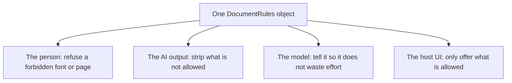

If each had its own copy of the constraint they would drift. One object feeds all four.

### Content levels

The headline setting is `content`. It is an abstraction over tags, so a host can say what it means without listing tags.

| | `text` | `rich` | `free` |
|---|---|---|---|
| Headings, paragraphs, lists, plain wrappers | yes | yes | yes |
| Images | no | yes | yes |
| Links | no | yes | yes |
| Tables | no | yes | yes |
| SVG | no | no | yes |
| `position: absolute / fixed` (free-floating) | no | no | yes |

`allow` switches any one of those on or off on top of the level (`{ content: "text", allow: { images: true } }`). `tags` replaces the level with an exact list (`["h1", "p", "ul", "li"]`). `<style>` is always allowed, because that is how a document looks.

**Alternatives.**

| Option | Verdict |
|---|---|
| Only an explicit tag allowlist | Precise but nobody wants to maintain `["h1","h2",...]` per product. |
| Only fixed presets | Not flexible enough. |
| **Presets plus overrides plus an exact list** (chosen) | The easy case is one word; the odd case is possible. |

### Fonts

`fonts: ["Inter", "Georgia"]` limits which families a document may name. Generic families (`serif`, `sans-serif`, `monospace`...) are always fine.

Fonts hide in more places than `font-family`:

| Where | Handled |
|---|---|
| `font-family: Papyrus, serif` | yes |
| `font: italic 12px/1.4 Papyrus` (shorthand) | yes: `shorthandFamilies` finds the part after the size |
| `--heading-font: Papyrus` (a custom property) | yes: `FONT_PROPERTY` recognises names like `--font`, `--heading-font`, `--font-family` but not `--font-size` |
| `@import url(...family=Lobster...)` | yes: `familyOfFontUrl` reads the family from the URL |
| `font-family: var(--f)` | no: it cannot be resolved here, so it is checked where the variable is set |

**This is best effort, not a CSS engine.** It works on declarations with a regex. The honest guarantee is: a font stated plainly is caught; a font assembled cleverly might not be. The hard limit on what *loads* is the Content Security Policy used when printing.

### Page rules

```ts
page: { sizes: ["A4", "Letter"], backgrounds: ["#ffffff", "#faf6ee"], margin: { min: 10, max: 30 } }
```

One entry in `sizes` or `backgrounds` locks it. `checkPage` returns a list of problems (size, margin, background). `fitPage` returns the nearest allowed page, for a host that wants to *start* from a valid page; it is never applied silently to an existing document.

Sizes are compared by dimensions with half a millimetre of slack, so `"A4"` and `{ width: 210, height: 297 }` are the same.

### Permissions

`permissions: { human: ["setText", "undo"] }` replaces the default list for that actor. Everything else fails with `not-allowed`. This is how a host makes a read-mostly document or a "review only" role.

### Two moments of enforcement

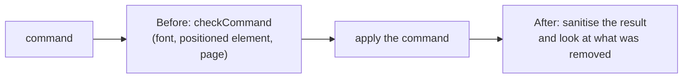

- **Before** (`command-checks.ts`): cheap and specific. "That font is not allowed" can be said *before* anything happens, with no change to undo.
- **After** (the sanitiser): the catch-all. Whatever the command produced is cleaned, so even a path the cheap checks missed cannot leave a document outside the rules.

### Who is refused and who is cleaned

This is the main behavioural decision. It is implemented in `editing/rule-gate.ts`, not here, but it is *why* the rules exist:

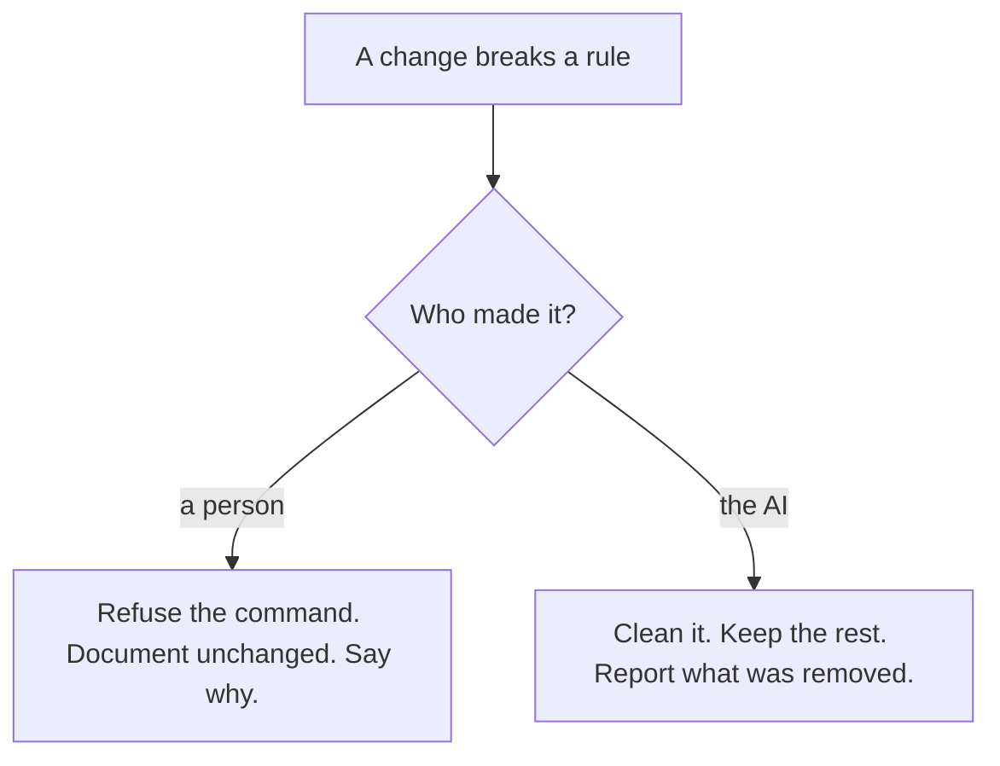

| Option | Verdict |
|---|---|
| Refuse the AI's whole revision on any violation | One stray `` throws away an otherwise good revision. |
| Silently clean a person's change | The person typed a forbidden font and nothing happened, with no explanation. |
| **Different treatment** (chosen) | A person can be told and can fix it. The AI cannot be asked, and the rest of its work is still worth reviewing. |

### Watch out

- **Rules apply to what changes, not to what is stored.** Loading a document that already breaks the rules does not clean it; the first change that touches it may be refused or cleaned.
- `describeRules` is *advice to a model*. Nothing relies on the model listening. The enforcement is on what comes back.

---

## Chapter 6: `sanitize`

**What it is.** The one door that model-written HTML (and anything else entering a document) comes through. It removes everything unsafe, applies the rules, and enforces one style per text element.

| File | What it does |
|---|---|
| `allowlists.ts` | The safe tags, safe attributes, and tags dropped with their contents. |
| `attributes.ts` | `keepsAttribute(el, name, value)`: may this attribute stay? |
| `violations.ts` | `Violations`: counts what the rules removed. `violationName(tag)`. |
| `sanitize.ts` | `sanitizeHtml(html, rules)` and `sanitizeFragment(root, rules)`. |

### The problem: the AI's output is untrusted

The AI's input can include hostile text: a pasted job ad, a web page. A prompt injection can make a model emit `` or a `<script>`. Even with one honest user, **treat model output like user input from the internet**.

### How it is defended

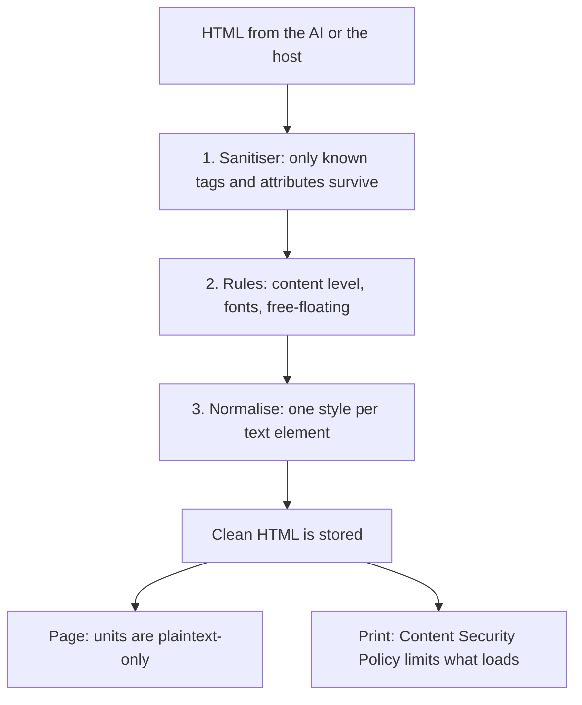

Defence in depth: the sanitiser is the first wall, but it is not the only one. `plaintext-only` stops typed or pasted markup; the CSP stops anything loading from elsewhere even if CSS gets through.

### An allowlist, not a blocklist

| Option | Verdict |
|---|---|
| Block known-bad tags (`script`, `iframe`...) | Every new browser feature is a new hole. |
| Use a library (DOMPurify) | A reasonable choice and worth reconsidering. It does not know about our rules or the one-style rule, so we would still need our own pass. |
| **Allowlist** (chosen) | Only known document tags and attributes survive. Unknown means gone. |

The details:

| Rule | Why |
|---|---|
| Tags in `DROPPED_TAGS` (`script`, `iframe`, `form`, `input`, `object`...) are removed **with their contents** | Their contents are code or data; unwrapping would leave it behind. |
| Other unknown tags are **unwrapped**, keeping their text | A model inventing `<custom-tag>` should not lose the words. |
| Attributes starting `on` are removed | Event handlers. |
| `href` must be `http(s):`, `mailto:`, `tel:` or `#` | `javascript:` links. |
| `src` must be `https:` or an inline `data:image/png|jpeg|gif|webp|avif` | Never `data:image/svg+xml`: SVG can carry script. |
| SVG links may only point inside the document | An SVG `<use>` of an external file. |
| `data-*` and `aria-*` always stay | The editor's own attributes are `data-*`. |

### How one element is processed

```mermaid
flowchart TB
  el["element, deepest first"] --> d{"In DROPPED_TAGS?"}
  d -- yes --> rm["remove with contents"]
  d -- no --> k{"A tag we know?"}
  k -- no --> un["unwrap: keep the text"]
  k -- yes --> r{"Against the rules?"}
  r -- "svg: remove whole. html tag: unwrap" --> rep["record a violation"]
  r -- no --> a["clean attributes and inline style"]
  a --> st{"A style element?"}
  st -- yes --> f["filter its CSS under the rules"]
```

**Why deepest first.** `root.querySelectorAll("*")` is reversed so children are handled before parents. Unwrapping a parent moves its children up; handling them first means none are skipped.

**Why SVG is removed whole but an HTML tag is unwrapped.** The children of an `<svg>` are shapes (`<path>`, `<circle>`); keeping them without the `<svg>` makes no sense. The children of a `<table>` are text, which is worth keeping when tables are not allowed.

### Reporting what was removed

`Violations` counts per kind. `violationName` chooses what a person would call it:

- a removed table is reported once as `table`, not once per cell,
- images as `image`, links as `link`.

That makes the notice readable: "removed 1 table, 2 images", not "removed 14 elements".

### Where it is called

- `RuleGate.enforce` after every command (so everything stored is clean),
- `RuleGate.clean` for the document you start with (violations dropped silently: no one to tell),
- the review (`proposeAi` goes through `enforce` as the AI).

**Watch out.**

- `Presentation.setHtml` does **not** sanitise. It trusts that what it is given has been through the gate. The review markup is built *from* clean HTML so that holds, but a new code path that hands the presentation raw HTML would be a hole.
- Each command parses the document three times (apply, sanitise, normalise). Fine for ordinary documents; a very large one would feel it. A single parse shared through the pipeline is a possible optimisation.

---

## Chapter 7: `knobs` and `fonts`

Two small, pure, string-only modules. No DOM.

### `knobs`

| File | What it does |
|---|---|
| `types.ts` | `Knob`: a number, a colour, or a choice. |
| `read.ts` | `readKnobs(html)`: finds the declarations. |
| `write.ts` | `formatKnobValue(knob, value)`, `setKnobs(html, values)`. |

**What a knob is.** A document says what is *worth adjusting* by writing a CSS variable with a comment:

```css
:root {
  --font-size: 10.5pt;  /* @knob "Font size" 8..14 step 0.25 */
  --accent: #1f3d63;    /* @knob "Accent colour" color */
  --density: cozy;      /* @knob "Density" options compact|cozy|airy */
}
```

A host can draw a slider, a colour picker and a dropdown from that, and the AI decides per document which three to seven values matter.

**The problem.** A global setting like "make everything a bit bigger" should be one control, not a hundred edits. But a fixed settings panel cannot know what a particular document is made of.

**Alternatives.**

| Option | Verdict |
|---|---|
| A fixed panel of settings | Cannot adapt to a document that has no headings or a two-column layout. |
| The person edits the CSS | Powerful, wrong tool for "a bit bigger". |
| **The document declares its own controls** (chosen) | The AI designs the knobs along with the layout. A knob is just a CSS variable, so changing one is an ordinary, undoable, diffable edit. |

**How writing works.** `setKnobs` rewrites the first declaration of each named variable, **inside `<style>` elements only**, and leaves every other byte unchanged. `formatKnobValue` clamps a number to the knob's range and adds its unit.

**Watch out.** A knob must be written exactly in the `--name: value; /* @knob ... */` shape. A knob whose value does not parse (a range with no number) is silently skipped.

### `fonts`

| File | What it does |
|---|---|
| `imports.ts` | `googleFontUrl(family)` builds the stylesheet URL. `addFontImport(html, url)` adds an `@import` at the top of the first `<style>`. |

**The problem.** A font chosen by hand must travel with the document into print and into the AI's next revision. If it lived in the host's page, the export would not have it.

**The solution.** A web font is an `@import` inside the document's own CSS. Nothing else is needed, and the rules (`fonts: [...]`) can see it and the CSP allows Google Fonts by default.

---

# Part 4: Understanding changes

This is the heart of "AI makes slop, a person catches it". The AI returns a whole new document. These two folders turn that into a list of specific changes the person can keep or undo.

## Chapter 8: `diff`

**What it is.** Finds what an AI revision actually changed, whatever it says it did.

| File | What it does |
|---|---|
| `types.ts` | `Unit`, `Change` (modified, added, removed, moved), `CssDiff`, `DocDiff`, `WordOp`. |
| `read-units.ts` | `readUnits(html)`: parse a document and list its units, with text, markup and block id. |
| `lcs.ts` | `lcsPairs(a, b)`: the longest common subsequence of two lists, as index pairs. The one LCS in the library. |
| `word-diff.ts` | `diffWords(before, after)`, `similarity(a, b)`. |
| `css-diff.ts` | `splitCssRules`, `diffCss`. |
| `matching.ts` | `Matching` and the three matching passes. |
| `document-diff.ts` | `diffDocuments(before, after)`: runs the passes and orders the result. |
| `scope.ts` | `actualScope`, `checkScope`, `humanEditsBetween`: the scope check. |

### The problem

The AI does not send a *patch*. It sends a complete new document, because that is what models do well. So to show "the AI changed these eleven things" you have to **work out what changed** by comparing two documents.

That is harder than it sounds, because **identity does not survive**. There is no reliable way to say "this paragraph in the new document is that paragraph in the old one": the model rewrote everything. The only thing to go on is *content*.

### Units are what get compared

The diff compares **units** (text elements and images), not raw HTML. Comparing HTML strings would flag a whole section as changed because a class was added; comparing units lets us say "this paragraph's *words* changed" separately from "this paragraph's *markup* changed".

Each unit records its `text` (whitespace collapsed), its `markup` (to catch a changed class or style), its tag and the `data-block` it sits in.

### Three layers

```mermaid
flowchart TB
  diff["Document diff"] --> text["Text: words changed inside a unit"]
  diff --> structure["Structure: units added, removed, moved"]
  diff --> sty["Style: the CSS, as one group"]
```

Each is reviewed differently:

- **Text** is shown word by word and kept or undone per paragraph.
- **Structure** is shown as markers on whole elements.
- **CSS** is one decision, because a CSS rule rarely affects only the element it was aimed at. Showing "this rule changed the colour of this one paragraph" would be false precision.

### Matching units: three passes

```mermaid
flowchart TB
  start["Old units and new units"] --> p1["Pass 1: identical text, same order<br/>(longest common subsequence)"]
  p1 --> p2["Pass 2: in the gaps between those anchors,<br/>pair units whose text is alike"]
  p2 --> p3["Pass 3: what is left with identical text<br/>on both sides moved; the rest was removed or added"]
```

An example:

```mermaid
flowchart LR
  subgraph old["Old document"]
    o1["Intro (same)"]
    o2["We shipped the editor today"]
    o3["Contact us"]
  end
  subgraph new["New document"]
    n1["Intro (same)"]
    n2["We shipped the new editor this week"]
    n3["A brand new paragraph"]
    n4["Contact us"]
  end
  o1 -- "pass 1: identical" --> n1
  o3 -- "pass 1: identical" --> n4
  o2 -. "pass 2: alike, so an edit" .-> n2
  n3 -. "pass 3: left over, so added" .-> n3
```

**Pass 1** (`matchIdentical`). Units with identical text in the same order are matched by the longest common subsequence. These are **anchors**. If only the markup differs, it is recorded as a formatting change.

**Pass 2** (`matchSimilar`). The anchors split the documents into gaps. Inside each gap, every old unit is scored against every new unit by `similarity` (shared words, order ignored, plus a small bonus for the same tag). Pairs above `0.35` are matched, best first. These are **edits**. Below the threshold, two paragraphs are "one removed, one added", not "one edited".

**Pass 3** (`matchLeftovers`). What is still unmatched, where the same text exists on both sides, is a **move**. The rest is **removed** or **added**.

**Why this order.** Identical text is certain, so it goes first and fixes the order. Similarity is a guess, so it only looks where the anchors leave room. A move is only inferred when nothing better explains the leftovers.

**Alternatives.**

| Option | Verdict |
|---|---|
| Match by `data-block` id | The AI is told to keep ids, but you cannot rely on it, and units inside a block still need matching. Ids are used as a *hint* for scope warnings, not for identity. |
| Diff the HTML strings (a text diff) | Reports noise (attribute order, whitespace) and cannot tell a move from a delete and an add. |
| A tree diff (like React's reconciliation) | Needs keys; the AI does not supply stable keys. |
| **Text-based matching** (chosen) | Needs nothing from the AI. Works on any document. Wrong in rare cases (see below). |

**Where it can be wrong.** A paragraph rewritten so heavily that nothing is shared looks like a removal plus an addition. Two nearly identical paragraphs (two list items "Item") can be paired the wrong way round. The review still shows every change, so the person sees it; it is a presentation inaccuracy, not data loss.

### The word diff

Inside an edited unit, `diffWords` shows exactly what changed. It splits text into words *and* whitespace tokens, finds the longest common subsequence (the same `lcsPairs`), and walks it to produce `equal`, `insert` and `delete` runs.

There is a size guard (4 million cells). Past it the whole text is "deleted, then inserted", because the table would be too large.

### The scope check: trust, checked

The AI declares a **scope** with its result (`text`, `section`, `layout`, `whole`) and the `data-block`s it meant to change. `checkScope` compares that with the diff:

```mermaid
flowchart LR
  said["AI said: scope + targets"] --> check{"checkScope"}
  did["Diff: what really changed"] --> check
  check --> w1["Broader than declared?"]
  check --> w2["Changes outside the named blocks?"]
  check --> w3["Changes to text the person typed?"]
```

| Check | How |
|---|---|
| **Broader than declared** | `actualScope` ranks the diff: over 60% of units changed is `whole`; a changed style sheet is `layout`; any add, remove or move is `section`; otherwise `text`. Warn if its rank is above the declared rank. |
| **Outside the targets** | Changes (other than markup-only ones) whose block is not in the AI's list. |
| **Touched human edits** | `humanEditsBetween` diffs the AI's last version against the current document to find text the person typed. A change whose *before* text is more than 85% similar to one of those is flagged. |

**The principle.** A prompt *asks* the AI to behave; this *checks* whether it did. An honest model's declaration just confirms the diff. A model that says "I fixed a typo" and rewrote the document triggers a warning that makes the review the right size of careful.

**Watch out.** These are heuristics with thresholds. They produce warnings, never decisions. Treat the numbers as tunable.

---

## Chapter 9: `review`

**What it is.** Everything about a proposed revision *after* it has been diffed: showing the changes on the page, keeping the person's decisions, and building the final document from what they kept.

| File | What it does |
|---|---|
| `attrs.ts` | The marker attributes: `data-vibedoc-change`, `-kind`, `-rejected`, `-ghost`. |
| `parsed.ts` | `parseBoth`: both documents parsed, with each old unit linked to the new element it became. `removedRoot`, `unitsWithin`. |
| `placement.ts` | `placeRemoved`: where to put old content back in the new document. |
| `apply-decisions.ts` | `applyDecisions`: the final document from the kept changes. |
| `word-marks.ts` | `markWordDiff`: marks inserted and deleted words inside an element. |
| `markup.ts` | `buildReviewHtml`: the document with its changes marked, for the page. |
| `session.ts` | `ReviewSession`: one open revision and the decisions on it. |
| `types.ts` | `ReviewSnapshot`, `ReviewChange`: what a host draws its review panel from. |

### The problem

The review does two different jobs from the same two documents:

```mermaid
flowchart TB
  base["Old document"] --> both["Diff"]
  prop["AI's document"] --> both
  both --> display["displayHtml:<br/>the new document with changes marked<br/>(what the person SEES)"]
  both --> final["finalHtml:<br/>the new document with rejected changes undone<br/>(what is COMMITTED)"]
```

Both are built from the **new** document, bringing old content back where needed. That is the design choice: start from what the AI wrote and undo selectively, rather than start from the old and apply selectively.

| Option | Verdict |
|---|---|
| Start from the old document and apply each accepted change | Needs each change to be an applicable patch. Our changes are *descriptions* found by matching, not patches. Applying "add this paragraph after that one" requires knowing where. |
| **Start from the new document and undo the rejected ones** (chosen) | "Keep all" is trivially the AI's document. Undoing edits and additions is local. Only removals need real work. |

### Showing changes on the page

`buildReviewHtml` marks the new document:

| Change | What the page shows |
|---|---|
| Edited text | `<ins>` around inserted words and `<del>` with the deleted words put back where they were. |
| Added | The element tagged `data-vibedoc-kind="added"` (green bar). |
| Moved | Tagged `moved` (blue bar). |
| Formatting only | Tagged `restyled` (purple bar). |
| Removed | A struck-through **ghost** copy of the old element, placed where it used to be. |
| Undone by the person | `data-vibedoc-rejected`: shown muted or hidden. |

The CSS for these markers is in `presentation/view/ui-styles.ts`.

**Marking words without breaking markup.** `markWordDiff` (in `word-marks.ts`) puts `<ins>` and `<del>` *inside* the element, splitting text nodes where needed, so a flex row of spans stays a flex row of spans. Inserted text is wrapped back to front so earlier positions stay valid; deleted text is put back at its character position.

### The hard part: putting removed content back

When the person rejects a *removal*, the old content must return to a document where the element it lived in may no longer exist. Where does it go?

`placeRemoved` tries, in order:

```mermaid
flowchart TB
  start["Old element to put back"] --> s1{"An old sibling before it<br/>that survived?"}
  s1 -- yes --> a1["Put it after that sibling's counterpart"]
  s1 -- no --> s2{"An old sibling after it<br/>that survived?"}
  s2 -- yes --> a2["Put it before that sibling's counterpart"]
  s2 -- no --> s3{"Any surviving unit nearby<br/>in reading order?"}
  s3 -- yes --> a3["Put it next to that unit"]
  s3 -- no --> a4["Append at the end"]
```

A **counterpart** of an old container is found by taking one of its surviving units and climbing as many levels in the *new* document as that unit sat below the container in the *old* one. That is how an old `<section>` finds the new `<section>` even though no one told us they were the same.

`placed` is a map of what has already been restored, so a run of removed paragraphs keeps its order: each anchors on the one restored before it.

**Whole sections.** If every unit in a removed section is rejected, the *section* comes back whole (`removedRoot` climbs while no ancestor holds a unit that survived). Otherwise unit by unit. A deleted section should not come back as loose paragraphs.

### Applying decisions

```mermaid
flowchart TB
  rej["Rejected changes"] --> kind{"Kind of change"}
  kind -- modified --> m["Replace the new element with a clone of the old"]
  kind -- added --> a["Remove the new element and any parent left empty"]
  kind -- moved --> mv["Remove from the new place, put back at the old"]
  kind -- removed --> r["Restore (section or unit) with placeRemoved"]
  css["CSS rejected"] --> c["Replace the new style elements with the old"]
```

Removals and moves are collected first and restored **in old-document order**, so each restored piece has the previous one to anchor on. Element references are captured before anything moves, so earlier edits do not invalidate later ones.

### `ReviewSession`

Holds `base` (the document), `proposal` (the cleaned AI document), the `diff`, the scope `report`, and the person's decisions (a set of rejected change ids plus a flag for the CSS).

| Method | What it does |
|---|---|
| `setAccepted(id, bool)`, `setCssAccepted`, `setAllAccepted` | Record decisions. |
| `keepsSomething` | Whether anything at all is kept; if not, finishing changes nothing. |
| `isPartial` | Whether some changes were undone (adds "(partly kept)" to the version summary). |
| `finalHtml()` | `applyDecisions(...)`. |
| `displayHtml()` | `buildReviewHtml(...)` with rejected changes marked. |
| `snapshot()` | The plain-data `ReviewSnapshot` a host draws from. |

**Why `snapshot` exists.** A host should not receive DOM nodes or diff internals. The snapshot is JSON-shaped: summary, scope report, one entry per change (kind, before, after, words, accepted, flags), the CSS group, and the rule violations.

**Watch out.**

- The review operates on **clean** HTML. `proposal.html` must already have been through the gate (the handler does this). Feeding it raw HTML would let unsafe content reach `displayHtml`.
- `buildReviewHtml` and `applyDecisions` each parse both documents again. Called on every decision toggle, it is wasteful but simple.
- Clicking a change *on the page* is not wired. Decisions come from the host's list.

---

# Part 5: The door

## Chapter 10: `editing`

**What it is.** The one place every change goes through. It is the only code allowed to write to the model.

| File / folder | What it does |
|---|---|
| `editing-core.ts` | `EditingCore`: owns the pieces and runs `dispatch(command, actor)`. |
| `status.ts` | `StatusMachine`: `idle`, `working`, `reviewing`, and which commands each allows. |
| `rule-gate.ts` | `RuleGate`: permission checks, and keeping results inside the rules. |
| `committer.ts` | `Committer`: records a change in history, versions and the model. |
| `context.ts` | `EditingContext` and `CommandHandler`: what handlers are given. |
| `handlers/` | `DocumentHandler`, `HistoryHandler`, `ReviewHandler`, `AiHandler`. |
| `apply/` | The appliers: what each document command does to the document. |
| `review-store.ts` | Holds the open `ReviewSession`, and tells listeners when it changes. |
| `history-key.ts` | Which commands share an undo step. |
| `human-edits.ts` | Text the person typed since the AI's last version. |
| `notices.ts` | The "rules removed something" notice. |

### The problem: five places to enforce, five ways to disagree

Without one door, each way of changing a document (typing, a button, undo, the AI) would check permissions, enforce rules, record history and update the model itself. Five copies means five chances to forget one. And the *order* matters: record the undo state **before** the change, announce the change **after** the version exists.

### What `dispatch` does

```mermaid
flowchart TB
  in["dispatch(command, actor)"] --> st{"Status allows this kind?"}
  st -- no --> f1["failure: locked / no-review / invalid"]
  st -- yes --> perm{"Actor may use this kind?"}
  perm -- no --> f2["failure: not-allowed"]
  perm -- yes --> pre{"Human? Cheap rule checks"}
  pre -- "font, page, position" --> f3["failure: rule-violation"]
  pre -- ok --> h["find the handler for this kind"]
  h --> run["handler.run(command, actor)"]
  run --> notices["emit each notice to listeners"]
  notices --> out["EditResult"]
```

The order is deliberate: **cheapest and most general first.** A locked document refuses everything before anyone looks at the command. Permission is checked before the rules because "you may not do this at all" is a better message than "this value is not allowed".

### Status: why the document locks

```mermaid
stateDiagram-v2
  [*] --> idle
  idle --> working: compose or revise starts
  working --> idle: AI failed, cancelled, or a new document applied
  working --> reviewing: a revision with changes arrives
  working --> idle: the revision changed nothing
  reviewing --> idle: finish or discard
```

| Status | Allowed |
|---|---|
| `idle` | document and history commands |
| `working` | only the AI's commands (the AI is writing; the person waits) |
| `reviewing` | only review commands |

**The problem.** The AI takes seconds. If the person keeps typing, the AI's result is based on a document that no longer exists. Merging the two is genuinely hard.

| Option | Verdict |
|---|---|
| Merge: rebase the AI's result over the person's edits | The right long-term answer (a three-way merge by unit), but a lot of work and many edge cases. Deferred. |
| Reject the AI's result if the document changed | Wastes the model call. |
| **Lock the document while the AI works** (chosen) | Nothing to merge. The cost is waiting. |

The lock is enforced in two places: the status check (commands fail with `locked`) and the presentation (units are made non-editable), so typing is blocked at the source too.

### The pieces

**`RuleGate`** has two jobs:

- `permits(actor, command)`: permission, and (for humans) the cheap rule checks.
- `enforce(state, actor)`: sanitise the result and apply the rules. For a **human**, any violation becomes a refusal. For the **AI**, violations are removed and returned so they can be reported.

**`Committer`** records a change in the right order:

```mermaid
sequenceDiagram
  participant H as DocumentHandler
  participant C as Committer
  participant U as UndoHistory
  participant V as VersionLog
  participant M as Model writer
  H->>C: commit(next, author, summary, key)
  C->>U: record(state from before, key)
  C->>V: record(next, author, summary)
  C->>M: commit(next)
  M-->>M: announce to subscribers
```

- Undo needs the state **from before**, so it is recorded first.
- The version is recorded **before** the model announces the change, so anyone who listens to the state and then reads `versions` sees both up to date.
- `moveTo` is used by undo and redo: it records a version but not a new undo step.

**Handlers.** Each group of commands has a handler with `handles(kind)` and `run(command, actor)`:

| Handler | Commands | What it does |
|---|---|---|
| `DocumentHandler` | the document commands | apply, enforce, commit |
| `HistoryHandler` | `undo`, `redo`, `restoreVersion` | move through history |
| `ReviewHandler` | decisions, finish, discard | edit the session, then commit only what was kept |
| `AiHandler` | `proposeAi`, `applyAiDocument` | start a review, or commit a new document |

| Option | Verdict |
|---|---|
| One big `switch` in `dispatch` | It would be the 1,500-line file again. |
| A class per command | A lot of ceremony for fourteen small functions. |
| **Handlers per family** (chosen) | Each is short, owns one kind of side effect, and shares the same context. |

### The appliers: what each command does

`apply/` holds **pure functions** from `(state, command)` to the next state. They check nothing about rules and record nothing.

```mermaid
flowchart TB
  cmd["DocumentCommand"] --> which{"Needs the tree?"}
  which -- "replaceAll, setPage,<br/>setKnob, addFontImport" --> sc["state-commands.ts:<br/>work on the whole state or the HTML string"]
  which -- "everything else" --> tc["tree-commands.ts"]
  tc --> parse["parseHtml(state.html)"]
  parse --> run["runTreeCommand: change the tree"]
  run --> back["toHtml(root) is the new html"]
```

| File | Commands |
|---|---|
| `set-text.ts` | `setText`: set a unit's text; refuses an element that holds other elements. |
| `split.ts` | `splitUnit` (Enter): the text after the caret moves to a copy of the element below. The copy loses `data-block` and `id`, which must stay unique. |
| `merge.ts` | `mergeUnits` (Backspace/Delete): joins with a neighbour of the **same kind**; a different kind never swallows another, but an empty one just goes away. |
| `structure.ts` | `moveElement`, `duplicateElement`, `removeElement`, `insertElement`. |
| `style.ts` | `setInlineStyle`, `setInlineCss`, `setStylesheet`. |
| `find.ts` | `find(root, path)` and `contentSibling` (the neighbour, skipping style elements). |

**Why the split between tree and state commands.** Some commands are easier as string work (a knob is a regex rewrite; a font import is adding a line). Parsing for them would be pure cost.

**Why pure.** An applier can be tested with a string in and a string out, no editor, no browser. `apply.test.ts` does exactly that.

### Locating elements safely

`find(root, path)` returns the element or a `failed("invalid", ...)`. The **root itself is never a valid target** (an empty path leads to the root). Tests of "a path that leads nowhere" rely on this.

### Pitfalls

- **Add a command** and you touch: `commands/commands.ts`, `commands/kinds.ts`, an applier, `tree-commands.ts` or `state-commands.ts`, and probably `rules/command-checks.ts`. See [Where do I add...?](#where-do-i-add).
- `EditingCore.rules` can be replaced at any time (`set rules`). It makes a new `RuleGate`; existing documents are not re-cleaned.

---

## Chapter 11: `ai`

**What it is.** The contract between the editor and "whatever calls a model", and the code that runs one request and hands the result to editing.

| File | What it does |
|---|---|
| `contract.ts` | `AiRequest`, `AiResult`, `AiEvent`, `AiProvider`, `readAiResult`. |
| `describe-page.ts` | `describePage(page)`: the paper in one sentence for a prompt. |
| `http-provider.ts` | `httpProvider(url)`: POSTs the request, reads streamed events back. |
| `run.ts` | `runProvider`: runs one request, with cancellation. |
| `commander.ts` | `AiCommander`: `compose`, `revise`, `cancel`, progress. |

### The principle: the AI is one function

```ts
type AiProvider = (request: AiRequest, options: { signal: AbortSignal })
  => AsyncIterable<AiEvent> | Promise<AiResult>;
```

VibeDocWithSoap never knows what is behind it: a model, your backend, a local model, a person, a canned result in a test.

| Option | Verdict |
|---|---|
| Ship an Anthropic (or OpenAI) client in the library | Picks a provider for the host and drags in an SDK. It also tempts you to put an API key in the browser. |
| Ship the prompts | Prompts are craft that belongs to the product built on top. The earlier version shipped them and every host had to fork. |
| Ship a server handler | The library should not decide your backend. |
| **A function** (chosen) | The host chooses everything. The library defines the shapes and checks what comes back. |

What VibeDocWithSoap *does* give a host to help: `describeRules`, `describePage`, `readAiResult` (to validate a model's output), `httpProvider` (a reference client), and [review-and-ai.md](review-and-ai.md) for the document contract.

### The request and the result

```mermaid
flowchart LR
  subgraph req["AiRequest"]
    k["kind: compose or revise"]
    h["html: the document as it stands"]
    i["instruction"]
    p["page"]
    r["rules"]
    he["humanEdits: text the person typed"]
    ctx["context: host background"]
  end
  subgraph res["AiResult"]
    rh["html: the whole document"]
    s["summary"]
    sc["scope"]
    t["targets: blocks changed"]
  end
  req --> fn(["Your AI function"]) --> res
```

`humanEdits` is how the AI is told "leave this alone": text the person typed since its last version. VibeDocWithSoap then *checks* whether it did (the scope check).

### How a request runs

```mermaid
sequenceDiagram
  participant H as Host
  participant A as AiCommander
  participant S as StatusMachine
  participant R as runProvider
  participant F as AI function
  participant C as EditingCore

  H->>A: revise(instruction)
  A->>A: provider set? status idle?
  A->>S: set working
  A->>R: run(request, signal)
  R->>F: call
  F-->>R: progress events (optional)
  R-->>A: onProgress(html)
  F-->>R: done with a result
  R-->>A: result, or an error
  alt result
    A->>C: dispatch(proposeAi or applyAiDocument, ai)
  else error or cancelled
    A->>S: set idle
    A-->>H: failure: ai-error or cancelled
  end
```

`runProvider` normalises the two shapes a provider may return (a promise of a result, or a stream of events) and turns every end into one of: a result, `CancelledError`, `EmptyResultError`, or the provider's own error.

**Cancellation.** `cancel()` aborts the `AbortController`. A `fetch` aborted mid-flight rejects with its own error; `runProvider` checks `signal.aborted` and reports a cancel regardless of what the error says. The status returns to `idle` and the document is unchanged.

### compose vs revise

| | `compose` | `revise` |
|---|---|---|
| Sends | the instruction (and the document, usually empty) | the document, the instruction, text the person typed |
| Result becomes | `applyAiDocument`: committed **at once** as an AI version | `proposeAi`: a **review** |
| Undo | brings the old document back | not needed: nothing changed until finished |

There is nothing to compare a brand new document with, so reviewing it change by change would be noise.

### Pitfalls

- The result is **not trusted at all**. `AiHandler` cleans it under the rules before anything else. A provider need not (and cannot) be relied on to do this.
- `httpProvider` expects newline-delimited JSON events. A server that sends a single JSON object needs a different provider (or to wrap it as one `done` event).
- The `claudeAi` provider in the example calls the API **from the browser with a key typed into the page**. It is for a demo and says so at the top of the file. It belongs on a server.

---

## Chapter 12: `persistence`

**What it is.** How a host saves and loads a document, without VibeDocWithSoap storing anything itself.

| File | What it does |
|---|---|
| `store.ts` | The `DocumentStore` interface: `load()` and `save(snapshot)`. |
| `memory-store.ts` | `MemoryStore`: for tests and demos. |
| `local-storage-store.ts` | `LocalStorageStore`: the browser's `localStorage`. |
| `autosave.ts` | `Autosave`: saves after changes, never overlapping. |

### The problem

VibeDocWithSoap has no backend and wants none. But documents must be saved. And saving is full of traps: a save in flight when the next change arrives, a save that fails, a flood of saves while someone types.

### A store is two functions

```ts
interface DocumentStore {
  load(): Promise<DocumentSnapshot | null>;
  save(snapshot: DocumentSnapshot): Promise<void>;
}
```

A snapshot is plain JSON (the state plus the versions). Implement the interface for your database, your API, or the browser. `MemoryStore` round-trips through JSON on purpose so it never holds anything a real store could not.

`LocalStorageStore.load` treats a damaged or outdated save as "no save" rather than throwing: the editor should still open.

### Autosave

```mermaid
stateDiagram-v2
  [*] --> waiting
  waiting --> scheduled: a change arrives (start the timer)
  scheduled --> scheduled: another change (restart the timer)
  scheduled --> saving: timer fires, or flush()
  saving --> saving: a change arrived during the save (dirty), save again
  saving --> waiting: nothing changed since
  saving --> failed: the store threw
  failed --> scheduled: the next change tries again
```

The rules:

1. **Debounce.** Wait (800 ms by default) after the last change.
2. **One save at a time.** A change that arrives during a save sets a dirty flag; when the save finishes the loop saves again. The store always ends with the latest document.
3. **A failure never loses anything.** The document is still in the editor. The status says `error` with a message, and the next change tries again.
4. **`flush()`** saves now and resolves when everything up to now is saved. Use it before navigating away.

| Option | Verdict |
|---|---|
| Save on every change | Floods the store; typing is dozens of changes a second. |
| Save only when the host calls `save` | Easy to forget; data loss. |
| Allow overlapping saves | A slow earlier save can land **after** a faster later one and overwrite it with older data. |
| **Debounced, serialised** (chosen) | Correct ordering, bounded load. |

### Pitfalls

- Versions are saved in full each time and never pruned. A long-lived document's snapshot keeps growing.
- `Autosave` reads the snapshot **when it saves**, not when the change happened. Because versions are recorded before the model announces a change, that read is always consistent.
- It does not know about the editor. It takes a small `SnapshotSource` (`onChange`, `snapshot`), which `editor.autosave(store)` supplies.

---

# Part 6: Showing the document

## Chapter 13: `rendering`

**What it is.** Turns the state into pages, and pages into a printable document. It reads the state and never writes it.

| File | What it does |
|---|---|
| `box-reader.ts` | `BoxReader`: what pagination needs to know about a laid-out document. `domBoxReader` reads it from the browser. |
| `flow.ts` | `flowChildren`, `isSplittable`: what takes part in the flow, and what may be cut. |
| `breaks.ts` | `findBreaks`: which elements start a new page. |
| `split.ts` | `splitIntoPages`: cut the document into one tree per page. |
| `paginate.ts` | `paginate`: breaks, then split. |
| `paginator.ts` | `browserPaginator`: lay the document out in a hidden element, measure, paginate. |
| `baseline-css.ts` | The CSS a document starts from, and `DOC_CLASS`. |
| `print-html.ts` | `buildPrintableHtml`, `contentSecurityPolicy`. |
| `print.ts` | `printHtml`: the browser's print dialog, from a hidden frame. |

### The problem

A document is one continuous flow of HTML. Paper comes in fixed-size sheets. Somewhere the flow has to be cut into pages, and **the pages on screen must be the pages in the PDF**.

This is where almost every HTML-to-paper tool fails: one line wraps differently, a print dialog adds its own margins, and a paragraph spills onto an extra page. The earlier version handed the browser a flowing document and asked it to paginate; screen and paper drifted.

### The approach: the browser measures, our code decides

```mermaid
flowchart LR
  html["HTML + page setup"] --> probe["Hidden element as wide as<br/>the page's content area"]
  probe --> wait["Wait for fonts and images<br/>(max 4 s)"]
  wait --> measure["BoxReader: top and bottom of every element"]
  measure --> breaks["findBreaks: pure code"]
  breaks --> split["splitIntoPages: pure code"]
  split --> pages["One DOM tree per page"]
  pages --> screen["PagedRenderer: sheets on screen"]
  pages --> print["buildPrintableHtml: sheets for print"]
```

The browser is only asked one question: *where is this element?* Everything after that is plain code that takes a `BoxReader`, so it is tested with a fake one (`rendering.test.ts` stacks elements with fixed heights).

| Option | Verdict |
|---|---|
| Let CSS paginate (`@media print`, `break-inside`) | The browser's choice, per browser, per print dialog. The exact problem we are avoiding. |
| One continuous flow on screen with spacer elements pushing content to the next page (the earlier version) | Works, but pages are not separate things: you cannot ask for "page 3", and the print document needed tricks to match. |
| Rasterise pages to images | Not selectable text, which fails for CVs that are read by software. |
| **Split into one tree per page** (chosen) | Each page is a fixed box. Printing is those boxes. |

The cost of the chosen approach is that editing happens in *pieces* of the document. That is why every element carries its path and why the editor restores the caret after each render.

### Finding the breaks

```mermaid
flowchart TB
  el["Next element in the flow"] --> fit{"Does it fit on this page?"}
  fit -- yes --> next["Leave it, go on"]
  fit -- no --> cut{"Can it be cut, and does it<br/>start on this page?"}
  cut -- yes --> inside["Look at its children one by one"]
  cut -- no --> top{"Already at the very top of a page?"}
  top -- yes --> over["Let it overflow: no empty page"]
  top -- no --> brk["Break before it. Pages start here."]
  brk --> tall{"Taller than a whole page<br/>and cuttable?"}
  tall -- yes --> inside
```

A worked example. Content height is 250 px; four paragraphs of 100 px:

```mermaid
flowchart LR
  subgraph page1["Page 1 (250 px)"]
    a["a 0-100"]
    b["b 100-200"]
  end
  subgraph page2["Page 2"]
    c["c 200-300"]
    d["d 300-400"]
  end
  b -. "c would end at 300 > 250: break before c" .-> c
```

`pageStart` becomes the top of `c`, so `d` is measured against it: 400 - 200 = 200 fits.

### What may be cut, and what is kept whole

`isSplittable(el)` is false (the element is kept whole) for:

| Kind | Why |
|---|---|
| A text unit or an image | Cutting a paragraph mid-line is a typesetting problem we are not solving. |
| A **row**: a table row, a flex or grid container | Cutting it splits columns across pages. |
| A `data-block` that holds no other block **and fits on one page** | The document says these belong together. |
| An element with no flow children | Nothing to cut between. |

A block taller than a page **is** cut, or it would overflow as one piece.

**Out-of-flow elements** (`position: absolute` or `fixed`) take no room, so they never cause a break. They stay on whatever page their parent ends up on.

**Overflow.** Something taller than a page that cannot be cut simply overflows, and *no empty pages are produced*. The test `lets something taller than a page overflow instead of leaving an empty page` is the specification.

**Tolerance.** Layout rounds to fractions of a pixel. A half-pixel slack stops content that fits exactly from being pushed to the next page.

### Splitting

`splitIntoPages(source, breaks)` makes one page per break plus one:

```mermaid
flowchart TB
  src["source tree with breaks at p3"] --> c1["copy 1"]
  src --> c2["copy 2"]
  c1 --> t1["keep everything before p3"]
  c2 --> t2["keep p3 and everything after"]
```

For each page it clones the whole tree, finds the page's start and end elements **by path in the clone**, then deletes what belongs to other pages:

- `dropBefore(start)`: remove everything before `start`, at every level up to the root (previous siblings of `start`, then of its parent, and so on).
- `dropFrom(end)`: remove `end` and everything after it, at every level.
- Then `removeEmptyUp`: if that left a container empty (a list whose first item started the next page), remove it too.
- Style elements are removed from the copy and **added again to every page**.

Both ends are found *before* anything is deleted, while the paths still lead to the right elements.

A list cut between items becomes two lists, because the container is copied across pages. Every element keeps its `data-vibedoc-path`, so a click or edit on page 3 still says where in the document it belongs.

### Measuring in the browser

`browserPaginator` creates a probe: a hidden `div` (`position: fixed; left: -100000px; visibility: hidden`) as wide as the page's content area, with the document inside. Hidden but laid out, because an element has to be rendered to be measured. It waits for `document.fonts.ready` and any images still loading, but never longer than four seconds, then measures, paginates and removes the probe.

**Why wait for fonts.** Where a line wraps decides where a page ends. Measuring with a fallback font and then showing the real one makes the breaks wrong.

### The baseline CSS

When a document is shown outside its own iframe, the browser's default margins and sizes would apply. `baseline-css.ts` pins them (zero margins, `box-sizing`, list styles). Every selector is wrapped in `:where(...)`, which gives it **zero specificity**, so whatever the document's own CSS says always wins. Without that, a document's `p { margin-bottom: 8pt }` would lose to the baseline's `* { margin: 0 }`.

### Printing

`buildPrintableHtml` produces a standalone HTML document: one `<section>` per page, each exactly one sheet (`@page { size: W H; margin: 0 }`), with the paper's colour and `break-after: page`. The last sheet is one pixel shorter so rounding can never push a blank page after it.

It carries a **Content Security Policy**: `default-src 'none'`, inline styles, and fonts and images from Google Fonts only (configurable). The browser enforces it, so no CSS trick makes a printed document call anywhere else.

`printHtml` puts the document in a hidden iframe and calls `print()`. "Save as PDF" in that dialog makes the file; no server.

### Pitfalls

- **Fonts differ between machines.** A PDF made on a server without Georgia breaks pages differently. Bundle web fonts for anything that must match exactly.
- A heading can be left at the bottom of a page (no "keep with next").
- `break-before` and `break-inside` in the document's CSS are not read.
- A margin at the top of continuing content is applied again, so it can sit slightly lower than measured.
- The probe is measured at the page's content width; a document whose layout depends on the *viewport* will differ.

---

## Chapter 14: `presentation`

**What it is.** The part that touches the browser's page. It draws, it listens, and it decides nothing.

```
presentation/
  view/       what is drawn
  adapter/    what the browser tells us
```

### `view/`

| File | What it does |
|---|---|
| `presentation.ts` | `Presentation`: shows HTML or pages, makes text editable, finds elements, forwards raw events. |
| `pages-view.ts` | `buildSheets`: one sheet of paper per page. |
| `ui-styles.ts` | `installUiStyles`: the baseline, the sheets and the review markers, installed once. |

**`Presentation` in one paragraph.** It is given a container. `setHtml` or `setPages` replaces what is inside; every text unit (an element that holds only text and is one of the `EDITABLE_TAGS`) is marked `data-vibedoc-unit` and made `contenteditable="plaintext-only"`. `unitOf(node)` finds the unit around a node, `byPath(path)` finds the element showing a document path, `setLocked(true)` removes editability (while the AI works), and every raw browser event inside it is passed on to listeners.

```mermaid
flowchart TB
  state["state.html"] --> render["renderer"]
  render --> p["Presentation.setHtml or setPages"]
  p --> dom["DOM in the container"]
  dom --> stamp["every element: data-vibedoc-path"]
  dom --> units["text units: data-vibedoc-unit + contenteditable"]
  dom --> events["raw events"]
  events --> listeners["listeners (the adapter)"]
```

### The problem: native editing, controlled

A `contenteditable` element hands you a caret, selection, spell check, IME, clipboard and undo for free. It also lets the browser do **unpredictable** things: Enter makes `<div>`s, Backspace merges across elements, a paste brings in markup.

| Option | Verdict |
|---|---|
| Build text input from scratch on a canvas or hidden textarea (like Google Docs) | Enormous. Re-implements IME, accessibility, selection. |
| Use `contenteditable="true"` on the whole document and fight the browser | The "rich-text editor" problem. |
| **`plaintext-only` per text unit** (chosen) | No formatting can be created. Each unit is its own editor. The browser's native text editing stays. We intercept only the few keys where structure would change. |

**The cost.** Where a browser lacks `plaintext-only`, the unit cannot be edited. The code does **not** fall back to rich text (that would let formatting and pasted markup in); instead `plaintextOnlySupported` becomes false and the text is read-only.

Why `setAttribute` and then reading `contentEditable` back: assigning the property throws in a browser that does not know the value; setting the attribute does not, and reading it back tells us whether the browser accepted it.

### Events

`RAW_EVENTS` is the curated list forwarded: `beforeinput`, `input`, `keydown`, `keyup`, `paste`, `cut`, `copy`, the three composition events, `focusin`, `focusout`, `pointerdown`, `pointerup`, `click`, `dblclick`, `contextmenu`, `dragstart`, `drop`, `selectionchange`. It is a *choice*: mouse moves, scroll and touch are not included.

| Detail | Why |
|---|---|
| Listeners are added in the **capture** phase | See the event before anything inside the document can stop it. |
| `selectionchange` is listened to on the **document** and forwarded only when the selection is inside the container | The browser fires it on the document, not the element. |
| `focusin`/`focusout`, not `focus`/`blur` | They bubble, so one listener on the container sees them all. |

### `adapter/`

| File | What it does |
|---|---|
| `presentation-adapter.ts` | `PresentationAdapter`: reports every raw event as a `vibedocwithsoap:<name>` custom event with the original event and the text unit it happened in. |
| `input-translator.ts` | `InputTranslator`: owns the handlers below. |
| `text-committer.ts` | Typing becomes one `setText` after a pause. |
| `key-handler.ts` | Enter, Backspace, Delete, undo, redo. |
| `paste-handler.ts` | Paste as plain text. |
| `selection-tracker.ts` | Which element was last clicked or typed in. |
| `caret.ts` | `caretOffset(unit)`, `placeCaret(unit, offset)`. |
| `sink.ts` | `CommandSink`: where commands go. |

```mermaid
flowchart TB
  dom["DOM events"] --> pres["Presentation"]
  pres --> adapter["PresentationAdapter: vibedocwithsoap:input, vibedocwithsoap:keydown..."]
  adapter --> tc["TextCommitter"]
  adapter --> kh["KeyHandler"]
  adapter --> ph["PasteHandler"]
  adapter --> st["SelectionTracker"]
  tc --> sink["CommandSink -> Editor.dispatch"]
  kh --> sink
```

The adapter is **the one door between the DOM and the rest of VibeDocWithSoap**: everything above it deals in commands, never in browser events. The events are not cancelable on purpose: the adapter reports, it does not decide. To cancel the browser's behaviour a handler calls `preventDefault()` on the *original* event.

### Typing

```mermaid
flowchart LR
  i["input event in a unit"] --> p["pending = that unit"]
  p --> t["(re)start a 400 ms timer"]
  t --> q{"Composing<br/>(input method)?"}
  q -- yes --> t
  q -- no --> f["flush: send setText"]
  fo["focusout"] --> f
```

`TextCommitter` only watches. The browser has already changed the text; this reads the unit's text back (`unitText`: `<br>` as `\n`) and sends one `setText(path, text)`. During an input method's composition (Japanese, Chinese, Korean) it keeps waiting: re-rendering in the middle of a composition would break it.

### Keys

| Key | What happens |
|---|---|
| Ctrl/Cmd+Z, Ctrl/Cmd+Y, Ctrl/Cmd+Shift+Z | `undo` / `redo`, after flushing pending typing. Prevented, so the browser's own undo (which does not know our history) does not run. |
| `beforeinput` of type `historyUndo`/`historyRedo` | Same, for the browser's Edit menu. |
| **Enter** in a paragraph-like unit | `splitUnit` at the caret. |
| Enter elsewhere, or Shift+Enter | A line break inside the unit (`execCommand("insertLineBreak")`). |
| **Backspace** at the very start of a unit | `mergeUnits` with the previous one. |
| **Delete** at the very end | `mergeUnits` with the next one. |
| Anything else | Left to the browser. |

```mermaid
sequenceDiagram
  participant K as Keyboard
  participant H as KeyHandler
  participant E as Editor
  participant C as EditingCore
  K->>H: keydown Enter
  H->>H: not composing, unit found
  H->>H: preventDefault, flush pending typing
  H->>H: caret offset in the unit
  H->>E: splitUnit(path, offset)
  E->>C: dispatch
  C-->>E: result with focus: new element, offset 0
  E->>E: render, then place the caret there
```

If a join has nothing to join with (`failed`), the key is **not** prevented, so Backspace at the start of the first paragraph just does what the browser does.

During **composition** the key handler returns at once: an input method owns the keyboard.

### Paste

The browser's paste would bring in markup from Word or a web page. `PasteHandler` prevents it, takes the plain text, collapses whitespace to single spaces (a unit is one line unless it has a break) and inserts it with `execCommand("insertText")`.

### The caret

`caretOffset(unit)` counts characters up to the caret, treating a `<br>` as one character, matching how `unitText` reads text. `placeCaret(unit, offset)` walks the unit's children to the right text node and sets the selection. Both are only meaningful for units, which contain nothing but text and line breaks.

### Pitfalls

- `execCommand` is deprecated. It still works in current browsers and is used in two places (the line break and paste). There is no good replacement for inserting text *as an undoable native edit*.
- IME handling is by not interfering. It has not been tested with a real input method.
- The page is not sanitised here (see the sanitiser chapter's watch-out).

---

## Chapter 15: `editor`

**What it is.** The one object a host uses. It wires the editing core, the presentation, the adapter, a renderer, the AI commander and autosave together.

| File | What it does |
|---|---|
| `editor.ts` | `Editor`: the public object. |
| `create-editor.ts` | `createEditor(options)`: builds the core and an `Editor`. |
| `renderer.ts` | `Renderer`, `RenderRequest`, `FlowRenderer`. |
| `paged-renderer.ts` | `PagedRenderer`. |
| `caret-keeper.ts` | `saveCaret`, `restoreCaret`. |
| `inspect.ts` | `describeElement`: an element described for a style panel. |
| `events.ts` | `EditorEvents`: what the host can listen to. |
| `export.ts` | `printableHtml(state)`, `printDocument(state)`. |

### What a host sees

```mermaid
flowchart TB
  subgraph in["Host sends"]
    d["dispatch(command)"]
    c["compose / revise / cancel"]
    p["print / printableHtml"]
    s["autosave(store)"]
    set["ai = fn, rules = ..."]
  end
  editor["Editor"]
  subgraph out["Host reads and hears"]
    r["state, status, review, selection, versions, canUndo"]
    e["events: state, status, review, notice, selection, progress"]
  end
  in --> editor --> out
```

Everything else the host needs (a toolbar, a chat, a review panel) is built from those, as the example app shows.

### The render loop

The editor listens to the model. On every state change it draws again:

```mermaid
flowchart TB
  change["model changed / status changed / review changed"] --> save["saveCaret: where is the caret now?"]
  save --> req["RenderRequest: state, origin, html override"]
  req --> r["renderer.render"]
  r --> done{"Async?"}
  done -- "yes (pages)" --> wait["wait for the pages"]
  done -- no --> fin
  wait --> fin["finish: lock, restoreCaret, drop a selection that points at nothing"]
```

**The `html` override.** While reviewing, `html` is the document with changes marked; the renderer draws that instead of `state.html`.

**The `origin`.** After typing, the page already shows the new text. `FlowRenderer` skips the redraw for `origin: "typing"`. `PagedRenderer` repaginates (the text may have moved a page break) and the caret is restored.

### Why caret handling is centralised here

Three things move the caret: a render that replaces the page, a command that says where it should go (after Enter), and the person. The first two used to fight: a key handler placed the caret, then a render's restore put it back where it was before.

The rule now: **only the editor places the caret.** Commands return `focus`, the key handler does nothing with it, and the editor applies it *after* the render is finished (`#afterRender`: immediately for a synchronous renderer, after the promise for an asynchronous one).

```mermaid
sequenceDiagram
  participant K as KeyHandler
  participant E as Editor
  participant R as Renderer
  K->>E: dispatch splitUnit
  E->>E: core commits, state changes
  E->>R: render (saves caret first)
  R-->>E: (later) pages drawn
  E->>E: restore the old caret
  E->>E: then place the caret the command asked for
```

### Overlapping renders

Pagination waits for fonts, so two renders can overlap. `Editor` uses a **ticket**: each render takes the next number; only the render holding the newest ticket finishes (restores the caret, clears `#rendering`). `PagedRenderer` does the same so an older, slower render does not overwrite a newer one.

### `createEditor`

```ts
createEditor({ container, html?, page?, snapshot?, rules?, renderer? })
```

`snapshot` takes precedence over `html`/`page`. The default renderer is paged. The initial document is cleaned under the rules before it is shown.

### Export

`printableHtml()` and `print()` build the printable document from `state`, never from the live page: they paginate again in a hidden element. The title is the first heading.

### Pitfalls

- The `state` event fires **before** the page is redrawn.
- `dispatch` flushes pending typing first, so a command from a button always applies on top of what the person just typed.
- `editor.rules = ...` changes enforcement from now on; it does not re-clean the stored document.

---

# Part 7: Around the core

## Chapter 16: `packages/ui`

**What it is.** The framework-neutral way to use VibeDocWithSoap: a `<vibedoc-editor>` HTML element.

| File | What it does |
|---|---|
| `vibedoc-editor.ts` | `VibedocEditorElement`: the custom element. |
| `index.ts` | `defineVibedocElements()` registers it; importing the package registers it. |

```html
<vibedoc-editor></vibedoc-editor>
<script type="module">
  import "@vibedocwithsoap/ui";
  const el = document.querySelector("vibedoc-editor");
  el.html = "<h1>Hello</h1>";
  el.rules = { content: "rich" };
  el.addEventListener("vibedoc-state", (e) => save(e.detail.state));
</script>
```

### How it works

```mermaid
flowchart LR
  attr["Properties set: html, rules, ai, snapshot"] --> el["VibedocEditorElement"]
  el -- "connected to the page" --> create["createEditor(container = the element itself)"]
  create --> editor["Editor"]
  editor -- "state, status, review, notice, selection" --> events["vibedoc-* CustomEvents on the element"]
  el -- "element.editor" --> host["host drives it: dispatch, compose, print"]
```

- Properties set **before** the element is connected are its starting configuration (`html` becomes the initial document).
- Set **after**, `rules` and `ai` are applied directly; `html` becomes a `replaceAll` command (a person's change, so the rules apply); `snapshot` restarts the editor.
- Each editor event is re-dispatched as `vibedoc-<name>` with its arguments in `detail`, and bubbles.
- `element.editor` exposes the whole `Editor` for anything the properties do not cover.

### Decisions

| Option | Verdict |
|---|---|
| **Draw into the element itself (light DOM)** (chosen) | The document's CSS and the library's baseline apply to it, and the host's CSS can style the paper's surroundings. |
| Shadow DOM | Isolates CSS, but the document's own `:root` variables (knobs) and its styles would not reach in, and global styles for the sheets and review markers would have to be injected into the shadow root. |
| A React wrapper | Thin to write; not written yet. `useEffect` around `createEditor` would do it. |

**Why the `Base` class.** `HTMLElement` does not exist when a file is imported on a server. `Base` falls back to an empty class so the import does not throw.

**Watch out.** There is only one editor per element; reconnecting an element (moving it in the page) destroys and recreates the editor, losing undo history.

---

## Chapter 17: `examples`

These exist to try things quickly. They are **not** what VibeDocWithSoap offers, and may be rough.

### `examples/minimal`: a control panel

```
src/
  main.ts        creates the editor, autosave, the log
  panel/         one file per section of the panel
  ai/            mock-ai.ts, claude-ai.ts
  dom.ts         a tiny element builder
  sample.ts      a sample document with knobs
  rules.ts       rule sets to try
```

It covers every command and event: edit the selected element, insert elements (including a free-floating text box), change paper and colour, adjust the document's own knobs, switch rule sets, undo and versions, AI (mock or Claude), the review list, print.

Each panel section is `section(title, build)`: it rebuilds on every editor event, **unless a control inside it has focus** (so a colour picker keeps working while you drag).

### `examples/web-component`

The smallest use of `<vibedoc-editor>`: set `html` and `rules`, listen to `vibedoc-state`, call `undo` and `print` through `element.editor`.

### The Claude provider

`examples/minimal/src/ai/claude-ai.ts` calls the Anthropic API **from the browser** with a key typed into a prompt. It exists only so the whole flow can be tried. The file starts with a banner saying it belongs on a server. Anyone who can open the page can read the key.

---

## Chapter 18: Tests

`packages/core/test/`:

| File | Covers |
|---|---|
| `dom.test.ts` | parse, paths, units, text, normalisation. |
| `model.test.ts` | state model, undo history, versions, snapshots, page geometry. |
| `rules.test.ts` | content levels, fonts, freeform, page rules, permissions, command checks, `describeRules`. |
| `apply.test.ts` | every applier, string in and string out. |
| `editing-core.test.ts` | dispatch, the lock, permissions, rule refusals, versions. |
| `diff.test.ts` | word diff, similarity, CSS diff, document diff, scope check. |
| `review.test.ts` | proposals, decisions, restoring removals, and the AI commander (success, failure, cancel). |
| `persistence.test.ts` | stores and autosave (with fake timers). |
| `rendering.test.ts` | breaks and splitting with a fake measurer, and print HTML. |
| `presentation.test.ts` | stamping paths, unit marking, adapter events, typing commits. |

**How to read them.** Test names are sentences and are the specification: `lets something taller than a page overflow instead of leaving an empty page`. When behaviour is unclear, read the test names first.

**What is not covered.** Anything that needs a real browser: caret placement after a render, `execCommand`, real layout and pagination, the print dialog, IME, and the `Editor` facade end to end. The environment is `happy-dom`, which has no layout. Those are what to check by hand in the examples. The `BoxReader` interface exists precisely so the *logic* of pagination could be tested without layout.

**Everything was written without running it.** Start with `npm run typecheck` and `npm test` and expect some fixing.

---

# Part 8: Working in the code

## Where do I add...?

### A new command

1. `commands/commands.ts`: add it to the right union.
2. `commands/kinds.ts`: add its kind to the group array (`DOCUMENT_KINDS` etc.). The `satisfies` there will fail to compile if the name is wrong.
3. `editing/apply/`: write the applier. Decide whether it works on the tree (`tree-commands.ts`) or on the whole state (`state-commands.ts`), and add it to that switch. The compiler will complain if the switch is not exhaustive.
4. If a rule should be able to refuse it: `rules/command-checks.ts`.
5. If it should share an undo step in bursts: `editing/history-key.ts`.
6. `docs/commands.md`, a test in `apply.test.ts`, and a control in the example panel.

### A new rule

1. `rules/types.ts`: the field. `rules/resolve.ts`: its default.
2. Enforce it where it applies: tags (`rules/tags.ts`), CSS (`rules/css-filter.ts`), pages (`rules/page-rules.ts`), commands (`rules/command-checks.ts`).
3. `rules/describe.ts`: a sentence for the prompt.
4. A test in `rules.test.ts`, and `docs/rules.md`.

### A tag a document may use

`sanitize/allowlists.ts` (`HTML_TAGS`), and `rules/tags.ts` if a content level should include it. To make it editable on the page, add it to `EDITABLE_TAGS` in `presentation/view/presentation.ts`.

### A new event on the editor

Add it to `editor/events.ts`, emit it in `editor/editor.ts`, forward it in `packages/ui/src/vibedoc-editor.ts`.

### A new way to save

Implement `DocumentStore` (`load`, `save`). Nothing else changes.

### A new way to draw

Implement `Renderer` (`render`, `destroy`) and pass `renderer: (presentation) => new MyRenderer(presentation)` to `createEditor`.

### A new raw event to react to

Add it to `RAW_EVENTS` in `presentation/view/presentation.ts`. Handle it with `adapter.on("name", ...)` in a handler under `presentation/adapter/`, and register that handler in `InputTranslator`.

### Different page-breaking behaviour

`rendering/flow.ts` (what may be cut) and `rendering/breaks.ts` (the algorithm). Test it in `rendering.test.ts` with the fake measurer; no browser needed.

## Things that will confuse you

**Two kinds of "no".** A *refusal* is a normal result (`{ ok: false, error }`), returned. A thrown exception means a bug or something unexpected (a corrupt snapshot, a malformed request). Do not catch exceptions to handle a refused command.

**`#name` private members.** `#emit`, `#listeners` and the like use JavaScript's real private fields. They cannot be reached from outside the class, not even from tests or the browser console. If you need to inspect one, log it from inside.

**The state is a string, but a path lives in a tree.** A path is only meaningful relative to a particular parse of a particular string. Never keep one across a command that inserts or removes elements.

**There are two copies of every document on screen.** The *model* (a string) and the *page* (DOM). They agree except for a few hundred milliseconds after typing, when the page is ahead. They are reconciled by `setText`, and the page is redrawn from the model after each commit.

**Review HTML is not the state.** While reviewing, the page shows `displayHtml()` (changes marked, ghost copies of removed content). The state is still the unchanged document. A person's click during review would hit marked-up elements whose paths mean nothing; that is why editing is locked.

**`data-vibedoc-path` appears in two places.** On the live page (stamped by `Presentation.setHtml`, or inherited from the probe in paged mode), and in the print document (copied along, harmless). It is never in the stored state.

**The sanitiser runs more than once.** On the starting document, after every command, on every AI result. That is intentional: each is a place content enters, and cleaning is idempotent.

**`human` is a role, not a person.** A button in the host's toolbar dispatches as `human`. `ai` is only for the AI's own results. A host that wants a read-only user restricts `human` with the `permissions` rule.

**Versions versus undo history.** *Versions* are named, saved, and survive a reload (human or AI, with a summary). *Undo history* is in memory, per session, and holds whole earlier states. They record the same changes but serve different purposes and are separate lists.

**Why the folders each have an `index.ts`.** It lists what a folder offers the folders above it. Only `packages/core/src/index.ts` is the library's public API; anything else is internal and may change.

**`ChangeScope` and `ContentLevel` are unrelated.** `text/section/layout/whole` is what the AI *says* it changed. `text/rich/free` is what a document may *contain*. Two vocabularies, one shares a word.

## Where to go next

| If you want to... | Read |
|---|---|
| See what is decided and what is open | [DESIGN.md](../DESIGN.md), [decisions.md](decisions.md) |
| Know what is risky or unfinished | [known-issues.md](known-issues.md) |
| Look up a command | [commands.md](commands.md) |
| Write rules for a product | [rules.md](rules.md) |
| Connect an AI | [review-and-ai.md](review-and-ai.md) |
| Understand pages and printing | [rendering.md](rendering.md) |
| Follow the code style | [conventions.md](conventions.md) |
| Try it | `npm install`, then `npm run dev` |
